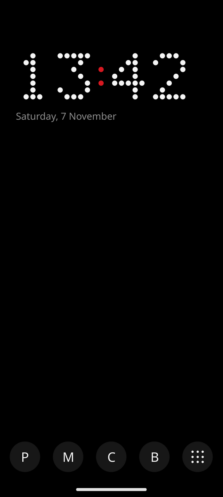
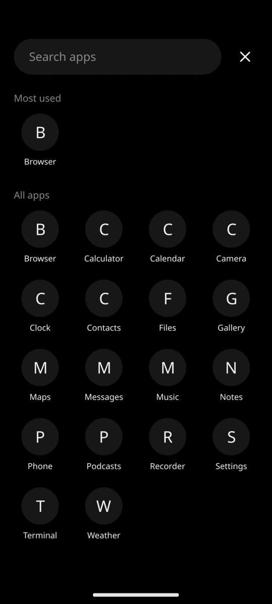
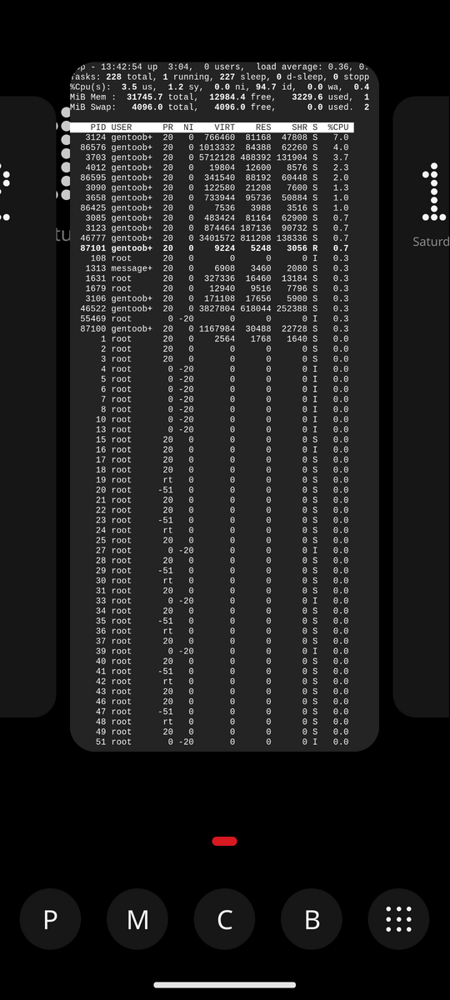
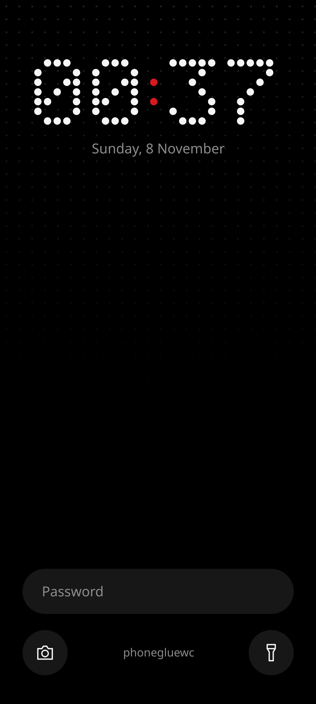
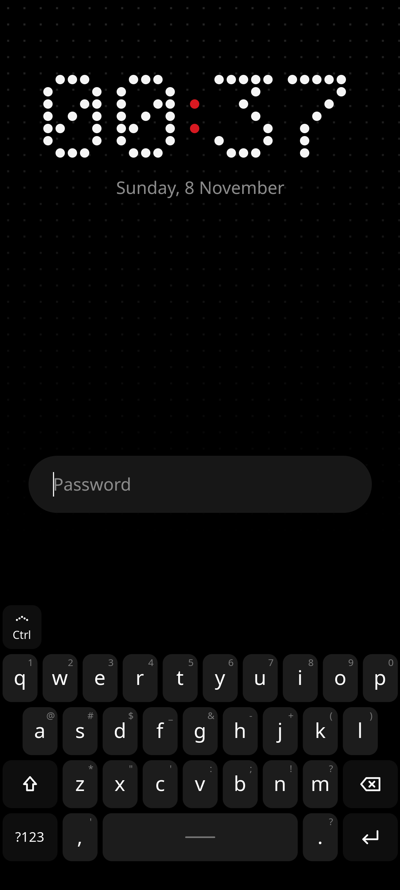
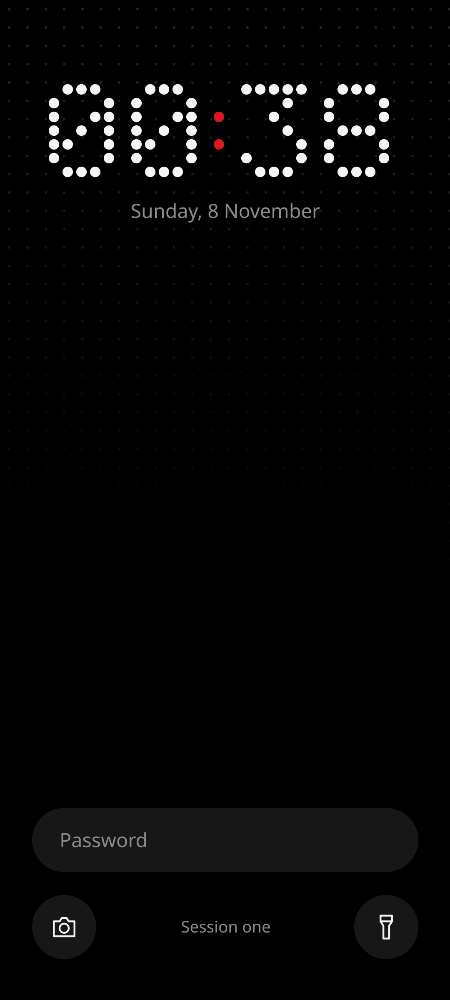

# phonegluewc

[](https://github.com/vladbiber/phonegluewc/actions/workflows/build.yml)
[](LICENSE)
[](https://gitlab.freedesktop.org/wlroots/wlroots/-/releases/0.20.2)

## Phone

This tree is the phone variant, made for a 1080x2400 OLED at scale 2.75. Every app
opens full screen on its own workspace. A pill at the bottom edge replaces the
navigation buttons: drag it up and the overview follows your finger. Drop a window
onto an occupied workspace in the overview to tile the two.

The shell in `shell/` starts with the compositor. It holds the home screen, the tray
and the app menu, which is loaded only while it is open. Hold an icon in the tray or the menu to pin
or unpin it. Pinned apps are listed one per line in `~/.config/phonegluewc/pinned-apps`,
apps you unpinned in `unpinned-apps` next to it, launch counts in
`~/.local/state/phonegluewc/app-usage.json`. Hyprland IPC and XWayland are compiled out.

`keyboard/` holds the on-screen keyboard, `phonekbd`. It starts with the compositor and
shows itself for any app using `text_input_v3`. Suggestions and corrections are offline,
in Romanian and English; `keyboard/data/SOURCES` has the word list licences. The key next
to the space bar switches to the laptop layout, with real Ctrl, Alt and Super. Set
`PHONEGLUEWC_KEYBOARD=` to run without it, or to another keyboard's command.

Hold still on the bar for half a second for screen text: `screentext/phonetext` freezes
the screen and reads it with tesseract, started just for that. Drag over text to Copy or
Search, or use Translate all. Tap away or touch the bar to leave. It needs `tesseract`
with `ron` and `eng` data and `wl-clipboard`; nothing is written to disk, and only Search
sends anything off the device. `screentext/setup-translation.sh` builds slimt and fetches
the two Bergamot models once; after that translation runs offline. Without it the rest still works.

The lock screen and the boot login look the same: wallpaper, large clock, one password field,
a shortcut in each bottom corner and a small session box. No user is named or listed. Lock with
`qs ipc -p shell call lock lock`. `login.conf` in the config directory sets `user=`, `left=`,
`right=` and `wallpaper=`. If the shell dies while locked the screen stays locked and a new shell
brings the field back, five times at most. For now the shortcuts are pictures and open nothing,
and the session box at the lock is only a label. `PHONEGLUEWC_GREETER=1` starts the boot login.
Neither real backend (PAM, greetd) has been run yet.

Try it on a laptop with `./run-on-laptop.sh`: a phone shaped window where the mouse is one
finger and holding F4 makes it four. Add `--lock` or `--login` for the password screens, which
take a fake password, `test`, and involve no PAM, greetd or real password.

  
  

Run the headless tests with `sh tests/touch-test.sh`, `bash tests/phone-test.sh`, `bash tests/pin-test.sh`,
`bash tests/frame-test.sh`, `bash tests/keyboard-test.sh`, `bash tests/lock-test.sh`,
`bash tests/screentext-test.sh`, `bash tests/statusbar-test.sh`, `bash tests/settings-test.sh`,
`bash tests/cursor-test.sh`, `bash tests/edge-test.sh`, `bash tests/fit-test.sh`,
`bash tests/uninstall-test.sh`, `bash tests/button-test.sh`, `bash tests/nav-test.sh`, `bash tests/drag-test.sh`,
`bash tests/anim-test.sh`, `bash tests/noclose-test.sh`, `bash tests/strip-test.sh`, `bash tests/momentum-test.sh`, `bash tests/kbdhide-test.sh` and `bash tests/laptop-env-test.sh`. `bash tests/realapps-test.sh` tries installed apps.
Each runs in a sandbox with an empty environment, a private bus and a short list of allowed
programs, and fails on any compositor crash or core file. `SAN=1` builds with ASan and UBSan.

phonegluewc is a compact, animated Wayland compositor built around automatic BSP
tiling. It combines a dwl-sized C codebase with workspaces, a GNOME-style
overview, touchpad gestures, runtime configuration and SceneFX visuals.

It is a fork of [dwl 0.8](https://codeberg.org/dwl/dwl), using
[wlroots 0.20](https://gitlab.freedesktop.org/wlroots/wlroots) and
[SceneFX 0.5](https://github.com/wlrfx/scenefx/releases/tag/0.5).


*The overview, then a cycle through the scroll and drift layouts.*


*Automatic BSP tiling. The bar is [glueqs](https://github.com/vladbiber/glueqs).*


*The overview: the workspace scaled down with its neighbours either side, and
the shell's dash along the bottom.*

There is a longer clip in
[docs/media/glue-demo.mp4](https://github.com/vladbiber/gluewc/raw/main/docs/media/glue-demo.mp4);
GitHub hands mp4 files over as downloads instead of playing them in the page.

## Highlights

- Automatic BSP tiling with per-split direction and ratio control
- Nine independent workspaces on every monitor
- Animated window open, close, retile and workspace transitions, with
  configurable type, duration and cubic-bezier easing
- GNOME-style overview with neighboring workspaces, live windows (a video
  keeps playing, a terminal keeps scrolling) and the wallpaper underneath; the
  session can open straight onto it, and every keybinding keeps working while
  it is up
- Every window and overview card is cut at the edge of its own monitor, so a
  strip that hangs off screen or a workspace sliding in never shows up on the
  monitor next door
- Niri-style scrolling layout per monitor (Mod-N): columns on an endless strip,
  vertical workspace slides and a vertical overview over the wallpaper
- driftwm-style drift layout (Mod-N again): windows keep their native size on
  an infinite canvas with edge snapping, per-workspace camera pan and zoom,
  and trackpad gestures for both
- Drag windows between workspaces directly from the overview
- Three-finger workspace and overview gestures
- Directional keyboard focus; crossing the left or right edge changes workspace
- Insert and normal keyboard modes inspired by modal window managers
- Runtime config and keybind reload without recompiling, applied as soon as the
  file is saved and reported on screen when a line does not parse
- Monitors set up from the same file and applied live: mode, position, scale,
  rotation, on/off, and mirroring one screen onto another or onto all of them
- Rounded corners, blur and optional transparency through SceneFX
- XWayland, layer-shell, session lock and output power-management support
- dwl IPC and foreign-toplevel support for bars and desktop shells
- Black fallback background when no wallpaper program is running

## Install

One script covers all four cases. It detects the distribution, installs the
build dependencies and audio, builds a compatible wlroots/SceneFX pair when
the distribution does not package one, and installs the session entry. It asks
for administrator privileges for the packages and the system install, and it
never writes to `~/.config/phonegluewc/config.conf`.

**Just the compositor:**

```sh
curl -fsSL https://raw.githubusercontent.com/vladbiber/gluewc/main/install.sh | sh
```

**With the bar** — [glueqs](https://github.com/vladbiber/glueqs), a quickshell
bar built for phonegluewc. Installs Quickshell from the distribution, or builds it
where there is no package (Chimera, Alpine, openSUSE), adds the tools its
panels use, clones the bar into `~/.config/quickshell/glueqs` and starts it
from the session:

```sh
curl -fsSL https://raw.githubusercontent.com/vladbiber/gluewc/main/install.sh | sh -s -- --with-bar
```

**Update an existing checkout** — pulls the newest source, rebuilds, installs,
and finishes by listing what the defaults gained that your own config does not
have. Your config is left alone; you copy across whatever you want:

```sh
cd phonegluewc && ./install.sh --update          # add --with-bar to update that too
./install.sh --check-config                 # only the list, no rebuild
```

**By hand**, to read the script first or to build without it:

```sh
git clone https://github.com/vladbiber/gluewc.git
cd phonegluewc
less install.sh
./install.sh          # or: make && sudo make install
```

The dependency resolver covers current releases of:

| Family | Target |
| --- | --- |
| Arch | Arch Linux, EndeavourOS, Manjaro, CachyOS, Garuda, Artix, ArcoLinux |
| Debian | Debian 13+, Devuan |
| Ubuntu | Ubuntu 25.10+, Mint, Pop!\_OS, elementary, Zorin, Kali, Raspberry Pi OS |
| Fedora | Fedora 43+, Nobara, RHEL, CentOS Stream, Rocky, AlmaLinux |
| SUSE | openSUSE Tumbleweed and Leap |
| Gentoo | Gentoo Linux |
| Alpine | Alpine Edge, postmarketOS |
| Chimera | Chimera Linux (clang, musl, dinit; `doas` is used when there is no `sudo`) |
| Void | Void Linux rolling |
| NixOS | through the flake in this repository, finix included |

A distribution outside the list still works: the installer falls back to
whichever package manager it finds on `PATH` and uses that family's package
set. Gentoo is hardware-tested and the Arch path is exercised by CI. The
remaining resolvers target their current package sets. Older distributions may
not have the Wayland, libdrm and Pixman versions required by wlroots 0.20; see
[the installation guide](docs/INSTALL.md) for manual and troubleshooting
instructions.

Sound is set up along the way: PipeWire, WirePlumber and the ALSA and
PulseAudio bridges are installed and, where there are systemd user units,
enabled. Pass `--no-audio` to keep your own audio stack.

### NixOS

```sh
nix run github:vladbiber/gluewc          # try it without installing
```

Permanently, add the flake as an input and enable the module, which registers
the session and sets up PipeWire, the portals and Xwayland:

```nix
imports = [ inputs.phonegluewc.nixosModules.default ];
programs.phonegluewc.enable = true;
programs.phonegluewc.bar.enable = true;   # the glueqs bar, with Quickshell from nixpkgs
```

### From source

```sh
git clone https://github.com/vladbiber/gluewc.git
cd phonegluewc
./install.sh --deps-only     # or install the dependencies yourself
make
sudo make install
```

[The installation guide](docs/INSTALL.md) covers `PREFIX`, `DESTDIR`,
`config.h`, building against a private wlroots and staying up to date.

After installation, log out and select **phonegluewc** in the display manager. From
a TTY, run:

```sh
phonegluewc-session
```

The default bindings expect `alacritty`, `rofi`, `grim` and `slurp` for
screenshots, `wl-clipboard` to put one on the clipboard, `playerctl` for the
media keys, and for volume and backlight either `wpctl`/`pactl` and
`brightnessctl`/`light`. The installer brings them in; they stay optional and
every command can be replaced in the runtime config.

## First steps

The session wrapper creates `~/.config/phonegluewc/config.conf` on first login.
Saving it applies it: the file is watched and reloaded on the spot, and
anything the parser rejects raises a red strip across the top of the screen
and a notification naming the line. `Super+Shift+R` still reloads by hand.

| Binding | Action |
| --- | --- |
| `Super` tap | Toggle overview |
| `Super+Return` or `Super+Q` | Open terminal |
| `Super+Space` | Open Rofi |
| `Super+1` … `Super+9` | Change workspace |
| `Super+Ctrl+1` … `Super+Ctrl+9` | Move window and follow |
| `Super+Arrow` or `Super+H/J/K/L` | Directional focus |
| `Super+Shift+Arrow` | Swap windows (nudge them in the drift layout) |
| `Super+N` | Cycle BSP, scroll and drift layouts |
| `Super+Ctrl+Arrow` | Move the window that way: swap with the neighbour, or on to the next workspace when there is none |
| `Super+Alt+Arrow` | Pan the drift canvas |
| `Print` / `Shift+Print` | Screenshot the screen / a selected area |
| `Ctrl+Print` / `Super+Shift+S` | The same, onto the clipboard |
| `Super+drag` | Swap the window with the tile it is dropped on |
| `Super+right-drag` | Resize the window against its neighbours |
| `Super+Shift+drag` | Drag the drift canvas around with the mouse |
| `Super+W`, `Super+±`, `Super+0` | Drift: fit, zoom, 1:1 |
| `Super+wheel` / `Super+Ctrl+wheel` | Change workspace / take the window along |
| `Super+Shift+wheel` | Zoom the drift camera |
| `Super+F` | Workspace-area fullscreen |
| `Super+Shift+F` | Real fullscreen |
| `Super+V` | Toggle centered floating |
| `Super+C` | Close window |
| `Super+O` | Toggle configured transparency |
| `Super+Escape` | Enter normal mode; `I` returns to insert mode |
| `Super+Shift+R` | Reload config in place (it also reloads itself when saved) |
| `Super+M` or `Super+Shift+Q` | Quit phonegluewc |

Media, volume and backlight sit on the function row, so they work on keyboards
without media keys or with them behind `Fn`. The media keys themselves keep
doing the same thing, and in normal mode the same keys need no `Super`.

| Binding | Action |
| --- | --- |
| `Super+F1` | Play / pause |
| `Super+F2` / `Super+F3` | Previous / next track |
| `Super+Shift+F2` / `Super+Shift+F3` | Seek 10s back / forward |
| `Super+F4` / `Super+Shift+F4` | Mute output / microphone |
| `Super+F5` / `Super+F6` | Volume down / up |
| `Super+F7` / `Super+F8` | Backlight down / up |

Playback needs `playerctl`. Volume goes through `wpctl` (part of WirePlumber,
so it is there on any PipeWire system) and falls back to `pactl`; the backlight
goes through `phonegluewc-backlight`, which drives `brightnessctl` (or `light`) in
5% steps down to 10% and 1% steps below that, so it reaches 0 and turns the
panel off. Every one of these is a plain `spawn:` line in the config, so they
can be pointed at anything else.

In the overview, use arrows, workspace numbers, the mouse wheel or a two-finger
horizontal swipe to navigate. Click a window to focus it, or drag it onto the
left, center or right workspace. Every `Super` binding still works while it is
up — open a terminal, close a window, switch layouts — and the cards follow;
`Super+1…9` and the workspace bindings move the overview instead of switching
underneath it. `start_in_overview = true` opens the session on it.
A three-finger horizontal swipe changes the
workspace from the desktop; a three-finger vertical swipe opens or closes the
overview. `Super+wheel` also changes workspace. In the drift layout three
fingers pan the canvas and a pinch zooms it, so four fingers take over
workspaces and the overview there.

## Desktop components

phonegluewc deliberately does not bundle a bar, launcher or wallpaper daemon.
Layer-shell clients reserve their own space, and wallpaper layers are included
in the overview.

Examples for `~/.config/phonegluewc/config.conf`:

```ini
autostart = swaybg -i ~/Pictures/wallpaper.jpg -m fill
autostart = waybar
```

With no wallpaper program, `root_color = 000000` keeps the background black.
Waybar can use its `dwl` workspaces module; desktop shells can also consume the
foreign-toplevel protocol. For shells without a dwl-ipc module phonegluewc keeps
`$XDG_STATE_HOME/phonegluewc/workspaces` up to date (one line per output: name,
active, workspace, window counts, layout) and installs `phonegluewc-msg`, which
speaks the same protocol from the command line:

```sh
phonegluewc-msg status                        # one line per output
phonegluewc-msg outputs                       # geometry, modes, mirror of each monitor
phonegluewc-msg -o eDP-1 workspace 3          # view workspace 3 there
phonegluewc-msg move 2                        # send the focused window to 2
phonegluewc-msg layout scroll
phonegluewc-msg -o eDP-1 power off            # switch the panel off (on brings it back)
```

### glueqs

[glueqs](https://github.com/vladbiber/glueqs) is a Quickshell desktop shell
written alongside phonegluewc: a dot-matrix bar with workspaces, tray, media,
network, weather and notifications, plus OSDs, a launcher, the wallpaper (it
paints it itself, with a picker on `Super+W`) and a dash that appears over the
overview. It is the shell in the video above. It runs on upstream Quickshell,
so it works with whatever `quickshell` your distribution packages.

It is entirely optional — phonegluewc runs with waybar, any other layer-shell bar,
or none at all — but it is the combination the compositor is developed against:

```ini
autostart = qs -c glueqs
```

### MacShell and other Hyprland shells

phonegluewc answers Hyprland's IPC: the request and event sockets under
`$XDG_RUNTIME_DIR/hypr/phonegluewc-<display>/`, the `hl.dsp.*` dispatchers, and the
toplevel export and mapping protocols that window previews use. The signature
is not exported to the session, so programs only take phonegluewc for Hyprland when
they are pointed at it; `phonegluewc-hyprctl` (also installed as `hyprctl` in
`/usr/lib/phonegluewc/bin`) is a client for it.

[MacShell](https://github.com/0-ss/MacShell), the macOS Tahoe style menu bar,
Dock and lock screen by Rickky and vSuol, runs on it this way. Glue Linux
packages it with a launcher that sets this up:

```ini
autostart = glue-macshell
```

## Configuration and building

- [Installation and distro notes](docs/INSTALL.md)
- [Configuration, actions and gestures](docs/CONFIGURATION.md)
- [Default runtime config](config.def.conf)
- [Contributing](CONTRIBUTING.md)

Manual build, once dependencies are installed:

```sh
make
sudo make install
```

Compiled defaults remain in `config.def.h`; normal users only need the runtime
config. Run `man phonegluewc` for command-line and environment details.

## License and credits

phonegluewc is GPL-3.0-or-later. It stands on:

- [dwl](https://codeberg.org/dwl/dwl), which grew from the wlroots TinyWL
  example and carries code influenced by [dwm](https://dwm.suckless.org) and
  [sway](https://swaywm.org)
- [wlroots](https://gitlab.freedesktop.org/wlroots/wlroots) and
  [SceneFX](https://github.com/wlrfx/scenefx) (MIT)
- [niri](https://github.com/YaLTeR/niri) and
  [driftwm](https://github.com/malbiruk/driftwm), whose layouts the scrolling and
  drift modes follow
- [Hyprland](https://hyprland.org), whose IPC it speaks for shells like
  [MacShell](https://github.com/0-ss/MacShell)

See `LICENSE*` and the Git history for the complete notices.
